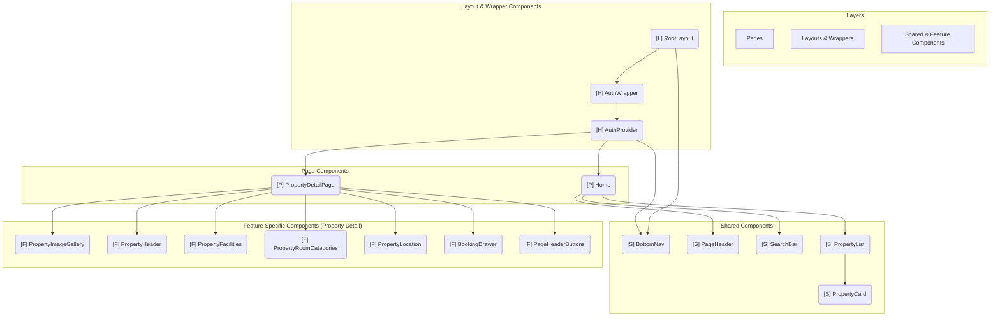

# Frontend Architecture Analysis

This document provides a detailed analysis of the Next.js frontend architecture, focusing on project-specific components, reusability patterns, and configuration management as requested for academic documentation.

---

## 1. Frontend Component Diagram

This section outlines the structure and dependencies of the frontend components created specifically for this project.

### Component Diagram Notation

The following notation is used in the Mermaid diagram to classify components:

- **`[P] -- Name`**: A Page-level component, serving as an entry point for a route.
- **`[L] -- Name`**: A Layout component that defines a shared UI structure.
- **`[F] -- Name`**: A Feature-specific component, typically complex and composed of smaller parts, but tied to a particular domain (e.g., property details).
- **`[S] -- Name`**: A Shared or Reusable component, designed for broad use across different pages and features.
- **`[H] -- Name`**: A Higher-Order or Wrapper component, primarily used for providing context or managing global state.
- **`[C] -- Name`**: A Client component with significant logic, state management, and data fetching responsibilities.

### Component Classification and Analysis

#### Page-level Components

- **`[P] Home (/app/page.tsx)`**: The main landing page.
  - **Responsibility**: Displays a list of properties that users can search and browse.
  - **Data/Props**: Manages `properties` state, `isLoading` flag, and `searchQuery`.
  - **Dependencies**: Uses `[S] PageHeader`, `[S] SearchBar`, and `[S] PropertyList`.

- **`[P] PropertyDetailPage (/app/[propertyId]/page.tsx)`**: Displays the full details of a single property.
  - **Responsibility**: Orchestrates the presentation of property images, details, facilities, rooms, and location. It handles user interactions like sharing and navigation.
  - **Data/Props**: Uses the `usePropertyLoader` hook to fetch and manage the `property` object.
  - **Dependencies**: Composes the view using multiple feature-specific components: `[F] PageHeaderButtons`, `[F] PropertyImageGallery`, `[F] PropertyHeader`, `[F] PropertyFacilities`, `[F] PropertyRoomCategories`, `[F] PropertyLocation`, and `[F] BookingDrawer`.

#### Layout Components

- **`[L] RootLayout (/app/layout.tsx)`**: The root layout for the entire application.
  - **Responsibility**: Provides the basic HTML document structure and wraps all pages with global providers and UI elements.
  - **Data/Props**: Receives `children` (the current page).
  - **Dependencies**: Uses `[H] AuthWrapper` to provide authentication context and `[S] BottomNav` for global navigation. It also includes `BookingProvider`.

#### Shared/Reusable Components

- **`[S] BottomNav (/app/_components/BottomNav.tsx)`**: The main navigation bar at the bottom of the screen.
  - **Responsibility**: Provides consistent, app-wide navigation links. It conditionally renders based on the current route.
  - **Data/Props**: None. It internally uses the `usePathname` hook.
  - **Dependencies**: None.

- **`[S] PageHeader (/app/_components/PageHeader.tsx)`**: A header component displayed on pages.
  - **Responsibility**: Renders a title or a promotional banner.
  - **Data/Props**: `title` (optional string), `isHost` (optional boolean).
  - **Dependencies**: None.

- **`[S] SearchBar (/app/_components/SearchBar.tsx)`**: An interactive search input component.
  - **Responsibility**: Captures user search queries and communicates them to the parent component.
  - **Data/Props**: `onSearch` (callback function), `value` (string).
  - **Dependencies**: None.

- **`[S] PropertyList (/app/_components/PropertyList.tsx)`**: A component that renders a grid of properties.
  - **Responsibility**: Displays a collection of properties by mapping data to `PropertyCard` components.
  - **Data/Props**: `properties` (array of `Property` objects).
  - **Dependencies**: `[S] PropertyCard`.

- **`[S] PropertyCard (/app/_components/PropertyCard.tsx)`**: A card that displays a summary of a single property.
  - **Responsibility**: Shows key property details (image, title, price) and links to the detail page.
  - **Data/Props**: `property` (`Property` object).
  - **Dependencies**: None.

#### Feature-specific Components (Property Detail)

- **`[F] PropertyImageGallery`**: Displays a gallery of property images.
- **`[F] PropertyHeader`**: Shows the property's title, address, and rating.
- **`[F] PropertyFacilities`**: Lists available facilities.
- **`[F] PropertyRoomCategories`**: Shows the different types of rooms available.
- **`[F] PropertyLocation`**: Displays the property's location on a map.
- **`[F] BookingDrawer`**: A sticky drawer for initiating the booking process.
- **`[F] PageHeaderButtons`**: Navigation buttons (back, share) for the page header.

#### Higher-Order/Wrapper Components

- **`[H] AuthWrapper (/app/_components/AuthWrapper.tsx)`**: Wraps the app to provide authentication context.
  - **Responsibility**: Ensures that the `AuthProvider` is available to the entire component tree.
  - **Data/Props**: `children`.
  - **Dependencies**: `[H] AuthProvider`.

- **`[H] AuthProvider (/app/_components/AuthContext.tsx)`**: Manages authentication state.
  - **Responsibility**: Handles user login/logout, fetches user profiles, and provides user data and authentication status to any component via the `useAuth` hook.
  - **Data/Props**: `children`.
  - **Dependencies**: None.

### Mermaid Component Diagram



---

## 2. Shared Components & Reusability Analysis

The project effectively utilizes shared components to maintain consistency and reduce code duplication.

### Shared Components

| Component                         | Reusability Rationale                                                                                                                                             | Consumers      | How It Improves Quality                                                                                                                                         |
| --------------------------------- | ----------------------------------------------------------------------------------------------------------------------------------------------------------------- | -------------- | --------------------------------------------------------------------------------------------------------------------------------------------------------------- |
| **`BottomNav`**                   | Provides a global, consistent navigation experience required on multiple top-level pages.                                                                         | `RootLayout`   | **Consistency & Maintainability**: Ensures all pages share the exact same primary navigation structure. Changes are made in one place.                          |
| **`PageHeader`**                  | Offers a standardized page heading format that can be used on any page needing a prominent title or banner.                                                       | `Home`         | **Consistency**: Enforces a uniform look and feel for page titles.                                                                                              |
| **`SearchBar`**                   | Encapsulates the UI and state logic for a search input, making it easy to add search functionality anywhere.                                                      | `Home`         | **Separation of Concerns**: The parent page does not need to know about the internal state of the input field, only the final search query.                     |
| **`PropertyList`**                | Abstracts the logic of rendering a grid of properties. It can be reused on any page that needs to display a list of properties (e.g., search results, favorites). | `Home`         | **Reuse & Flexibility**: Decouples the list layout from the data source. Can be configured with different props to alter its display.                           |
| **`PropertyCard`**                | Represents a single, self-contained unit of UI for a property. It is the fundamental building block for any property listing.                                     | `PropertyList` | **Modularity & Reuse**: The most reused component in property-centric views. Encapsulates all presentation logic for a property summary.                        |
| **`AuthWrapper`, `AuthProvider`** | Provides a centralized system for managing global authentication state, accessible from any component in the tree.                                                | `RootLayout`   | **Centralized State Management**: Prevents prop-drilling and provides a single source of truth for user authentication, simplifying state logic across the app. |

### Consumer Components

| Component                | Consumed Shared Components                | Purpose                                                                                      |
| ------------------------ | ----------------------------------------- | -------------------------------------------------------------------------------------------- |
| **`RootLayout`**         | `BottomNav`, `AuthWrapper`                | Establishes the global application shell and context.                                        |
| **`Home`**               | `PageHeader`, `SearchBar`, `PropertyList` | Composes the main landing page from reusable blocks.                                         |
| **`PropertyList`**       | `PropertyCard`                            | Builds a grid view by repeatedly rendering the `PropertyCard` for each item in its data set. |
| **`PropertyDetailPage`** | (Consumes Feature-Specific components)    | Assembles a detailed view by composing multiple specialized components.                      |

---

## 3. Frontend Configuration (No Hardcoding)

The project follows best practices for managing configuration, ensuring that environment-specific values are not hardcoded within the application's source code. This enhances flexibility and deployment readiness.

### Environment Variables (`.env`)

The primary mechanism for externalizing configuration is through environment variables, managed via `.env` files (e.g., `.env.local`, `.env.production`).

- **File Names**: `.env.local` is used for local development, and the build server would use a corresponding file for production.
- **Example Variable**: `NEXT_PUBLIC_API_BASE_URL`
- **Usage Explanation**: This variable defines the base URL for the backend API.
  - **`lib/apiClient.ts`**: A generic `request` function uses `process.env.NEXT_PUBLIC_API_BASE_URL` to prefix all outgoing API calls. This allows the application to target a local development server (`http://localhost:8000`) and a production API (`https://api.example.com`) without any code changes.
    ```typescript
    // In lib/apiClient.ts
    const BASE_URL = process.env.NEXT_PUBLIC_API_BASE_URL
    // ...
    let response = await fetch(`${BASE_URL}${endpoint}`, config)
    ```
  - **`app/_components/PropertyCard.tsx`**: The component constructs full image URLs using the same base URL, ensuring that images are correctly fetched from the backend's storage.
    ```typescript
    // In app/_components/PropertyCard.tsx
    const API_BASE_URL = process.env.NEXT_PUBLIC_API_BASE_URL
    // ...
    const [imgSrc, setImgSrc] = useState(
      // ...
      new URL(property.images[0].filePath, API_BASE_URL).toString()
      // ...
    )
    ```

### Next.js Configuration (`next.config.ts`)

Build-time and server-level configurations are managed in `next.config.ts`.

- **File Name**: `next.config.ts`
- **Usage Explanation**: This file is used to configure Next.js features. In this project, it is used for:
  - **Image Optimization**: The `images.remotePatterns` configuration whitelists a specific hostname (`cp25nk2.sit.kmutt.ac.th`). This is a security and optimization feature that tells Next.js it is safe to accept and optimize images from this trusted external source.
    ```typescript
    // In next.config.ts
    const nextConfig: NextConfig = {
      images: {
        remotePatterns: [
          {
            protocol: 'http',
            hostname: 'cp25nk2.sit.kmutt.ac.th',
            // ...
          },
        ],
      },
      // ...
    }
    ```
  - **Custom Build Steps**: The `webpack` function is modified to add a custom loader (`@svgr/webpack`) for handling SVG files as React components, demonstrating how the build process itself can be configured.

### Benefits of this Approach

- **Flexibility**: Developers can switch between different API environments (local, staging, production) simply by changing environment variables, without touching the source code.
- **Security**: Secret keys or sensitive URLs are kept out of version control (by adding `.env.*` files to `.gitignore`).
- **Maintainability**: Configuration is centralized in predictable locations (`.env` files and `next.config.ts`), making it easy to manage and update.
- **Deployment Readiness**: The application can be seamlessly deployed to various hosting platforms (like Vercel or AWS) by setting the required environment variables in the deployment environment.
